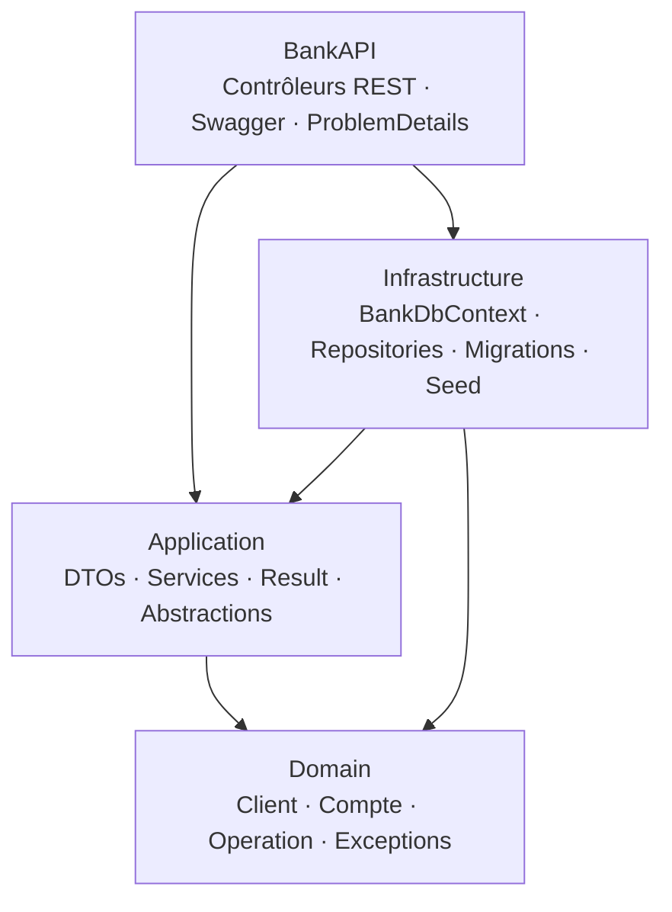

# CleanArchBank — API bancaire en Clean Architecture


API REST de **gestion de comptes bancaires** en **ASP.NET Core (.NET 10)**, organisée selon les
principes de la **Clean Architecture**. Les clients possèdent des comptes, les comptes reçoivent
des versements, retraits et virements, et les règles métier (solde suffisant, atomicité des
virements, suppression contrôlée) sont appliquées dans le domaine et la couche Application.

---

## Sommaire

- [Architecture](#architecture)
- [Modèle de domaine](#modèle-de-domaine)
- [Fonctionnalités](#fonctionnalités)
- [Stack technique](#stack-technique)
- [Structure du dépôt](#structure-du-dépôt)
- [Prérequis](#prérequis)
- [Configuration](#configuration)
- [Lancer le projet](#lancer-le-projet)
- [Migrations EF Core](#migrations-ef-core)
- [Endpoints de l'API](#endpoints-de-lapi)
- [Exemples de requêtes](#exemples-de-requêtes)
- [Tests unitaires](#tests-unitaires)
- [Choix techniques](#choix-techniques)
- [Pistes d'amélioration](#pistes-damélioration)
- [Auteur](#auteur)

---

## Architecture



| Couche | Projet | Rôle | Dépendances |
|---|---|---|---|
| Domaine | `Domain` | Entités `Client`, `Compte`, `Operation`, enum `OperationType`, exceptions métier. | Aucune |
| Application | `Application` | DTOs, contrats de persistance, services applicatifs, `Result`/`ErrorType`, mappings. | `Domain` |
| Infrastructure | `Infrastructure` | `BankDbContext`, configurations EF Core, repositories, migrations, seed, DI. | `Application`, `Domain` |
| Présentation | `BankAPI` | Contrôleurs REST, Swagger, gestion d'erreurs RFC 7807, composition root. | `Application`, `Infrastructure` |

Le sens des dépendances va toujours vers le domaine : `BankAPI` ne référence jamais directement
les entités EF Core pour exposer les données, et les contrôleurs ne contiennent aucune règle métier.

---

## Modèle de domaine

```text
Client 1 ──── * Compte 1 ──── * Operation
                                  └── TypeOperation : Retrait | Versement | Virement
```

- **Client** : nom, prénom, e-mail unique, téléphone, adresse, image, date d'inscription.
  La propriété calculée `NomComplet` n'est pas persistée.
- **Compte** : numéro unique, type (`Courant`, `Épargne`…), solde `decimal(18,2)`, client
  propriétaire, date de création. Le solde possède un setter privé : il ne peut être modifié que
  par `Crediter`, `Debiter` ou `AjusterSolde`.
- **Operation** : type, montant strictement positif, date, libellé, compte rattaché.
- **Exceptions** : `DomainException` et `SoldeInsuffisantException` (qui expose le solde et le
  montant demandé).

Les invariants sont portés par les entités :

- un montant d'opération doit être strictement positif ;
- un débit supérieur au solde lève `SoldeInsuffisantException` ;
- un solde ne peut jamais devenir négatif ;
- un compte mouvementé ne peut pas être supprimé (contrôle applicatif, HTTP 409).

---

## Fonctionnalités

- CRUD des clients avec contrôle d'unicité de l'e-mail.
- Création, consultation, modification et suppression contrôlée des comptes.
- Recherche des comptes d'un client.
- Versements et retraits avec mise à jour atomique du solde et écriture d'une opération.
- Refus d'un retrait supérieur au solde (HTTP 400, aucune écriture).
- Virement atomique entre deux comptes : deux soldes et deux écritures dans une seule transaction.
- Extrait de compte filtré par date, trié chronologiquement.
- Agrégats : nombre d'opérations par client ou par compte, solde total d'un client, total des
  retraits d'un client.
- Erreurs normalisées RFC 7807 (`ProblemDetails`) : 400, 404, 409, 500.
- Swagger UI en développement avec documentation XML des contrôleurs.
- Jeu de données de démonstration au premier démarrage.

---

## Stack technique

| Élément | Version / choix |
|---|---|
| Runtime | .NET 10 (`net10.0`) |
| API | ASP.NET Core Web API |
| ORM | Entity Framework Core 10 |
| Provider MySQL | `MySql.EntityFrameworkCore` 10.0.12 (Oracle, sans Pomelo) |
| Base | MySQL 8.4 |
| Documentation | Swagger / OpenAPI (Swashbuckle 11.0.1) |
| Tests | xUnit 2.9.3, 21 tests |
| Validation | DataAnnotations + règles du domaine |

---

## Structure du dépôt

```text
CleanArchBank/
├── CleanArchBank.slnx
├── Domain/
│   ├── Entities/
│   │   ├── Client.cs
│   │   ├── Compte.cs
│   │   ├── Operation.cs
│   │   └── OperationType.cs
│   └── Exceptions/
│       ├── DomainException.cs
│       └── SoldeInsuffisantException.cs
├── Application/
│   ├── Abstractions/
│   │   ├── Persistence/
│   │   │   ├── IClientRepository.cs
│   │   │   └── ICompteRepository.cs
│   │   └── Services/
│   │       ├── IClientService.cs
│   │       └── ICompteService.cs
│   ├── Common/Result.cs
│   ├── DTOs/
│   ├── Mappings/MappingExtensions.cs
│   └── Services/
│       ├── ClientService.cs
│       └── CompteService.cs
├── Infrastructure/
│   ├── Persistence/
│   │   ├── BankDbContext.cs
│   │   ├── Configurations/
│   │   ├── Migrations/
│   │   ├── Repositories/
│   │   ├── Seed/DatabaseSeeder.cs
│   │   └── DesignTimeDbContextFactory.cs
│   └── DependencyInjection.cs
├── BankAPI/
│   ├── Controllers/
│   │   ├── ApiControllerBase.cs
│   │   ├── ClientsController.cs
│   │   └── ComptesController.cs
│   ├── Program.cs
│   └── appsettings.json
└── tests/
    └── CleanArchBank.UnitTests/
        ├── Application/
        ├── Domain/
        └── Fakes/
```

---

## Prérequis

- [.NET SDK 10](https://dotnet.microsoft.com/download)
- Un serveur **MySQL 8.4** accessible sur le port `3307`
- Facultatif : `dotnet-ef`

```powershell
dotnet tool install --global dotnet-ef
```

Avec Docker, le serveur MySQL du projet se lance en une commande :

```powershell
docker run -d --name cleanarchbank-mysql `
  -p 3307:3306 `
  -e MYSQL_ROOT_PASSWORD=root `
  -e MYSQL_DATABASE=cleanarchbank_db `
  mysql:8.4
```

---

## Configuration

`BankAPI/appsettings.json` :

```json
{
  "ConnectionStrings": {
    "DbConnection": "server=127.0.0.1;port=3307;database=cleanarchbank_db;user=root;password=root;CharSet=utf8mb4;SslMode=Disabled;"
  }
}
```

Adapte le port, l'utilisateur et le mot de passe à ton installation. La fabrique de design-time
utilise la variable d'environnement `CLEANARCHBANK_CONNECTION` si elle est définie, sinon la même
chaîne par défaut.

---

## Lancer le projet

```powershell
dotnet run --project BankAPI --launch-profile http
```

| Ressource | URL |
|---|---|
| API | <http://localhost:5052> |
| Swagger UI | <http://localhost:5052/swagger> |
| Santé | <http://localhost:5052/health> |
| Santé base | <http://localhost:5052/health/db> |

Au démarrage, l'API applique les migrations puis insère le jeu de démonstration si la table
`Clients` est vide : Amina Benali (comptes 1001 et 1002), Youssef El Amrani (2001) et
Sophie Martin (3001).

---

## Migrations EF Core

```powershell
# Appliquer les migrations
dotnet ef database update -p Infrastructure -s BankAPI

# Ajouter une migration après une modification du modèle
dotnet ef migrations add NomDeLaMigration -p Infrastructure -s BankAPI
```

La migration `InitialCreate` crée les tables `Clients`, `Comptes`, `Operations` et
`__EFMigrationsHistory`. Les clés étrangères sont en `Restrict` pour empêcher la suppression en
cascade d'un client ou d'un compte mouvementé.

---

## Endpoints de l'API

### Clients — `/api/clients`

| Méthode | Route | Description | Codes |
|---|---|---|---|
| `GET` | `/api/clients` | Liste des clients avec nombre de comptes et solde total. | 200 |
| `GET` | `/api/clients/{id}` | Détail d'un client. | 200, 404 |
| `POST` | `/api/clients` | Crée un client (e-mail unique). | 201, 400, 409 |

### Comptes — `/api/comptes`

| Méthode | Route | Description | Codes |
|---|---|---|---|
| `GET` | `/api/comptes` | Liste des comptes avec leur client. | 200 |
| `GET` | `/api/comptes/{id}` | Détail d'un compte. | 200, 404 |
| `POST` | `/api/comptes` | Crée un compte pour un client existant. | 201, 400 |
| `PUT` | `/api/comptes/{id}` | Met à jour numéro, type et client. | 200, 400, 404 |
| `DELETE` | `/api/comptes/{id}` | Supprime un compte sans opération. | 204, 404, 409 |
| `GET` | `/api/comptes/search?clientId={id}` | Comptes d'un client. | 200, 404 |

### Opérations et agrégats

| Méthode | Route | Description | Codes |
|---|---|---|---|
| `POST` | `/api/comptes/{compteId}/operations` | Retrait ou versement. | 201, 400, 404 |
| `GET` | `/api/comptes/{id}/nombre-operations` | Nombre d'opérations d'un client. | 200, 404 |
| `GET` | `/api/comptes/{id}/operations/nombre` | Nombre d'opérations d'un compte. | 200, 404 |
| `GET` | `/api/comptes/{num}/extrait?date={date}` | Extrait à partir d'une date. | 200, 404 |
| `GET` | `/api/comptes/solde-total/{clientId}` | Somme des soldes d'un client. | 200, 404 |
| `POST` | `/api/comptes/virement` | Virement atomique entre deux comptes. | 204, 400, 404 |
| `GET` | `/api/comptes/total-retraits/{clientId}` | Somme des retraits d'un client. | 200, 404 |

---

## Exemples de requêtes

```powershell
# Créer un client
curl -X POST http://localhost:5052/api/clients `
  -H "Content-Type: application/json" `
  -d '{"nom":"Dubois","prenom":"Camille","email":"camille.dubois@example.fr","tel":"0611223344","adresse":"5 rue des Fleurs, 75012 Paris"}'

# Verser 500 EUR sur le compte 1
curl -X POST http://localhost:5052/api/comptes/1/operations `
  -H "Content-Type: application/json" `
  -d '{"typeOperation":"Versement","montant":500,"libelle":"Versement salaire"}'

# Retirer 200 EUR du compte 1
curl -X POST http://localhost:5052/api/comptes/1/operations `
  -H "Content-Type: application/json" `
  -d '{"typeOperation":"Retrait","montant":200,"libelle":"Retrait DAB"}'

# Virement de 500 EUR du compte 1 vers le compte 2
curl -X POST http://localhost:5052/api/comptes/virement `
  -H "Content-Type: application/json" `
  -d '{"compteSourceId":1,"compteDestinationId":2,"montant":500,"libelle":"Virement epargne"}'

# Solde total du client 1
curl http://localhost:5052/api/comptes/solde-total/1
```

Un retrait supérieur au solde retourne `400 Bad Request` avec un corps `ProblemDetails` :

```json
{
  "type": "https://tools.ietf.org/html/rfc9110#section-15.5.1",
  "title": "Requête invalide",
  "status": 400,
  "detail": "Solde insuffisant : solde disponible 3 000,00 €, montant demandé 999 999,00 €."
}
```

---

## Tests unitaires

```powershell
dotnet test
```

Les 21 tests couvrent :

- le domaine : crédit, débit, solde nul, solde insuffisant, montants invalides, numéro invalide ;
- les services : création de client, unicité de l'e-mail, création de compte, retrait accepté ou
  refusé, versement, suppression bloquée, virement valide ou refusé, agrégats de soldes.

Les repositories sont remplacés par des *fakes* en mémoire : les tests ne nécessitent ni base
MySQL ni serveur HTTP.

---

## Choix techniques

- **Provider Oracle `MySql.EntityFrameworkCore`** plutôt que Pomelo, conformément au TP.
- **Transactions explicites** dans `CompteRepository` pour les opérations et les virements :
  le solde et l'écriture sont validés ensemble ou pas du tout.
- **Pattern Result** (`Result`, `Result<T>`, `ErrorType`) : les services ne lèvent pas
  d'exception de contrôle de flux ; `ApiControllerBase` traduit le résultat en code HTTP.
- **DTOs séparés des entités** : aucune entité EF Core n'est exposée directement.
- **`AsNoTracking`** sur les lectures, index sur les clés étrangères et la date des opérations.
- **Montants en `decimal(18,2)`** et conversion UTC explicite des dates MySQL.
- **Seed idempotent** : exécuté uniquement si la base est vide.

---

## Pistes d'amélioration

- Authentification JWT et rôles (client, conseiller, administrateur).
- Validation centralisée avec FluentValidation et pagination des listes.
- Tests d'intégration avec `WebApplicationFactory` et une base MySQL de test.
- Journal d'audit des opérations et plafonds de retrait paramétrables.
- Conteneurisation complète de l'API et de la base avec `docker compose`.

---

## Auteur

**Alaa Chaabouni** — [@Ala012](https://github.com/Ala012)
