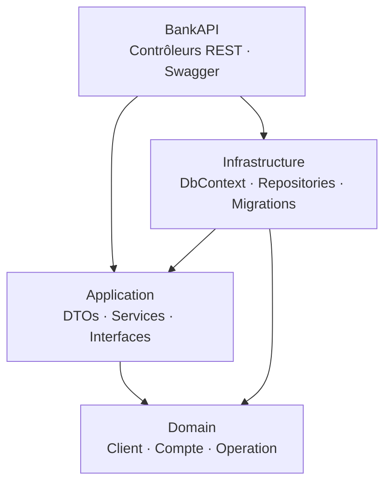

# CleanArchBank — API bancaire en Clean Architecture


Squelette d'une **API bancaire** en **ASP.NET Core (.NET 10)** organisée selon les principes de
la **Clean Architecture**. Le modèle de domaine et les DTOs principaux sont posés ; la
persistance, les services et les contrôleurs métier restent à implémenter.

> **État : work in progress.** Ce dépôt n'est pas encore une API fonctionnelle. Voir la
> [feuille de route](#feuille-de-route) pour les étapes restantes.

---

## Sommaire

- [Architecture prévue](#architecture-prévue)
- [Modèle de domaine](#modèle-de-domaine)
- [État d'avancement](#état-davancement)
- [Structure du dépôt](#structure-du-dépôt)
- [Prérequis](#prérequis)
- [Lancer le projet](#lancer-le-projet)
- [Feuille de route](#feuille-de-route)
- [Auteur](#auteur)

---

## Architecture prévue



| Couche | Projet | Rôle prévu |
|---|---|---|
| Domaine | `Domain` | Entités `Client`, `Compte`, `Operation`, enum `OperationType`, règles métier. |
| Application | `Application` | DTOs et services applicatifs (création de compte, retrait, versement, virement). |
| Infrastructure | `Infrastructure` | `DbContext`, repositories, migrations EF Core, configuration MySQL. |
| Présentation | `BankAPI` | Contrôleurs REST, injection de dépendances, documentation OpenAPI. |

---

## Modèle de domaine

Un **client** possède un ou plusieurs **comptes**. Chaque compte peut recevoir des
**opérations** : `Retrait`, `Versement` ou `Virement`.

```text
Client 1 ──── * Compte 1 ──── * Operation
                                  └── TypeOperation : Retrait | Versement | Virement
```

Entités déjà présentes :

- `Client` : nom, prénom, téléphone, email, adresse, image, collection de comptes ;
- `Operation` : type, montant (`decimal(18,2)`), date, compte associé ;
- `OperationType` : énumération des types d'opération.

DTOs déjà présents : `ClientDTO`, `CreateCompteDTO`, `UpdateCompteDTO`,
`CreateOperationDTO`, `OperationDTO`.

---

## État d'avancement

| Élément | État |
|---|---|
| Entité `Client` | ✅ |
| Entité `Operation` + `OperationType` | ✅ |
| Entité `Compte` | ⏳ classe vide à compléter |
| DTOs `Client`, `Operation` | ✅ |
| `CompteDTO` | ⏳ classe vide à compléter |
| Services applicatifs | ❌ à créer |
| `DbContext` + repositories | ❌ à créer |
| Contrôleurs Clients / Comptes / Opérations | ❌ à créer |
| Migrations EF Core | ❌ à créer |
| `CleanArchBank.slnx` | ⏳ solution vide |

`BankAPI` contient encore le contrôleur `WeatherForecastController` généré par le modèle
ASP.NET Core ; il sera supprimé une fois les contrôleurs métier en place.

---

## Structure du dépôt

```text
CleanArchBank/
├── CleanArchBank.slnx
├── Domain/
│   ├── Entities/
│   │   ├── Client.cs
│   │   ├── Compte.cs
│   │   ├── Operation.cs
│   │   └── OperationType.cs
│   └── Domain.csproj
├── Application/
│   ├── DTOs/
│   │   ├── ClientDTO.cs
│   │   ├── CompteDTO.cs
│   │   ├── CreateCompteDTO.cs
│   │   ├── UpdateCompteDTO.cs
│   │   ├── CreateOperationDTO.cs
│   │   └── OperationDTO.cs
│   └── Application.csproj
├── Infrastructure/
│   └── Infrastructure.csproj
└── BankAPI/
    ├── Controllers/WeatherForecastController.cs
    ├── Properties/launchSettings.json
    ├── Program.cs
    ├── appsettings.json
    └── BankAPI.csproj
```

---

## Prérequis

- [.NET SDK 10](https://dotnet.microsoft.com/download)
- Un serveur **MySQL 8** (prévu pour la persistance)

---

## Lancer le projet

```powershell
dotnet run --project BankAPI
```

L'application démarre sur `http://localhost:5052` et `https://localhost:7147`.
Le document OpenAPI est exposé sur `/openapi/v1.json` ; aucune interface Swagger n'est encore
configurée.

---

## Feuille de route

- [ ] Compléter l'entité `Compte` (numéro, solde, type, `ClientId`) et `CompteDTO`.
- [ ] Ajouter les références de projets entre `Application`, `Infrastructure` et `BankAPI`.
- [ ] Créer `ApplicationDbContext` et les repositories dans `Infrastructure`.
- [ ] Ajouter les packages EF Core + provider MySQL et générer la migration `InitialCreate`.
- [ ] Implémenter les services : création de client, ouverture de compte, retrait, versement,
      virement atomique.
- [ ] Exposer les contrôleurs `Clients`, `Comptes` et `Operations`.
- [ ] Ajouter la validation (solde suffisant, montant positif, compte existant).
- [ ] Configurer Swagger UI et documenter les endpoints.
- [ ] Remplir `CleanArchBank.slnx` avec les quatre projets.

---

## Auteur

**Alaa Chaabouni** — [@Ala012](https://github.com/Ala012)
